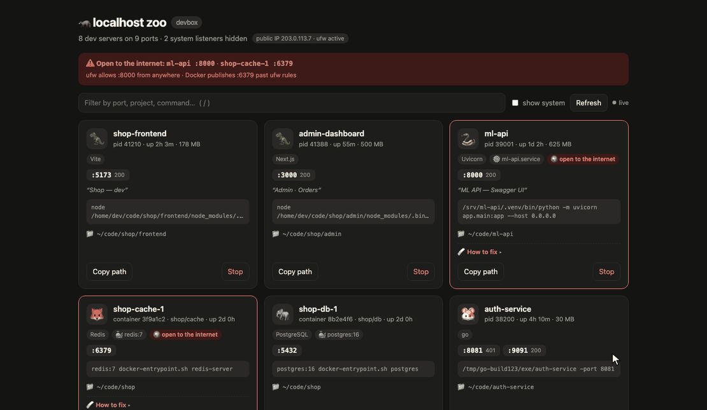
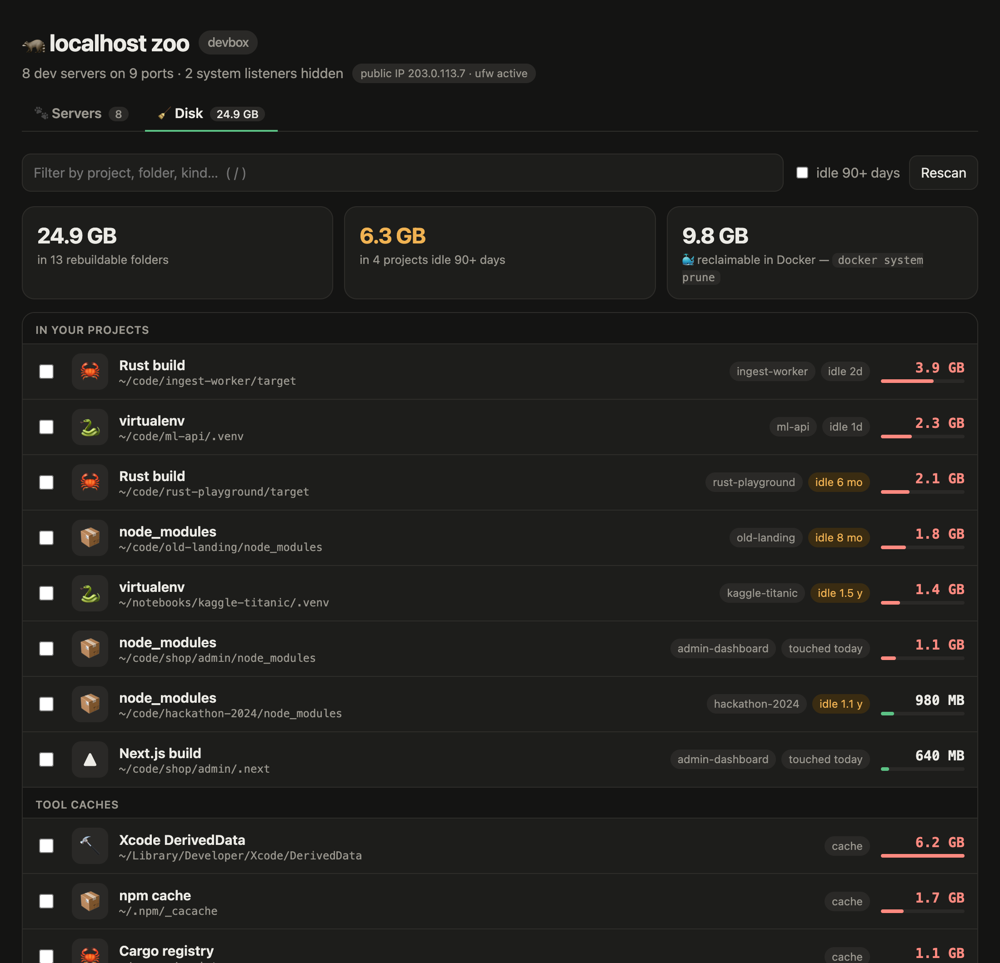
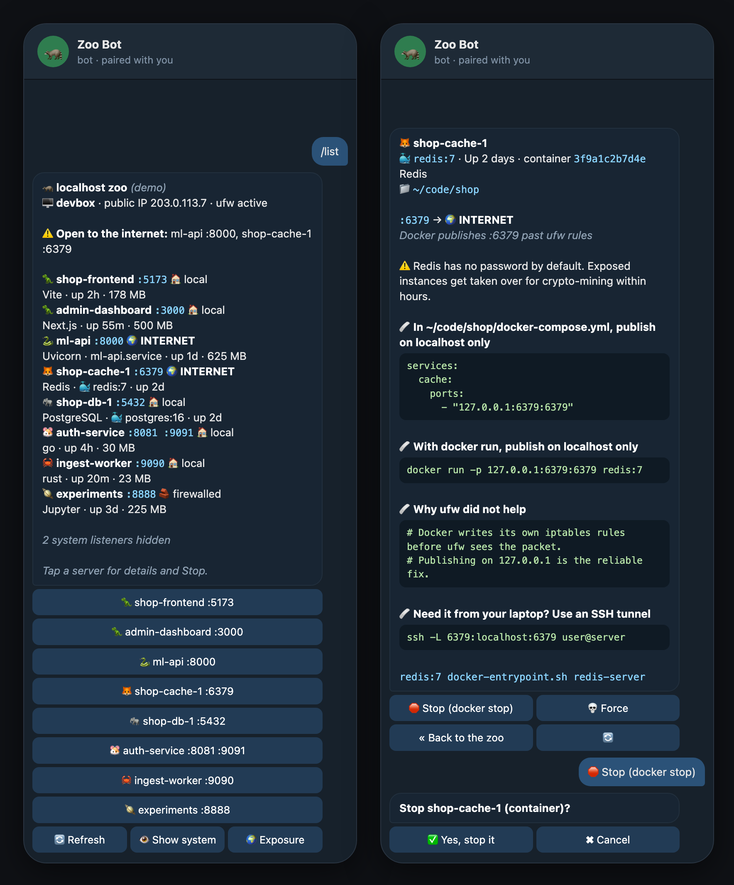

<div align="center">

# 🦝 localhost-zoo

**Every dev server on your machine in one live dashboard.**

Find out who is squatting on port 3000, which project it belongs to, and whether the whole internet can reach it. Get the exact command that fixes it. Stop it from your browser, your terminal or Telegram.


dashboard · terminal UI · Telegram bot · Docker & systemd aware · “open to the internet” check with fixes · MCP · zero dependencies

[Русская версия](README.ru.md)



</div>

---

## ✨ Features

- 🔎 **Finds everything that listens.** Vite, Next.js, Django, Uvicorn, Rails, Jupyter, Postgres, Redis, a forgotten `python -m http.server`…
- 🌍 **Tells you what the internet can reach.** It checks public IPs and ufw rules, and catches the classic trap where Docker publishes ports past ufw.
- 🩹 **Tells you how to fix it.** You get the exact line for your stack: `--host 127.0.0.1` for Vite, `bind` for Redis, `127.0.0.1:` in `docker-compose.yml`, a ufw rule, an SSH tunnel.
- 📱 **Telegram bot.** Every process in your pocket, with Stop buttons. It is paired to your account only.
- 🐳 **Knows your containers.** Instead of an anonymous `docker-proxy` you see `shop-db-1 · postgres:16`, and Stop runs `docker stop`.
- ⚙️ **Knows systemd.** It shows `ml-api.service` and stops it with `systemctl`, so it doesn't spring back to life a second later.
- 🔒 **Won't let you shoot yourself in the foot.** sshd and Docker itself can't be stopped by a misclick.
- 🖥 **`zoo top`.** An htop-style live view right in the terminal.
- 🧹 **Disk zoo.** Finds the gigabytes dev work quietly eats: `node_modules`, virtualenvs, Rust `target`, `.next`, npm/pip/Homebrew/Cargo caches, Xcode DerivedData. Pick and move to the Trash.
- 🤖 **MCP server.** Claude Code, Cursor and other agents can ask “what is on port 3000?” and free it.
- 📁 **Knows where each process came from.** Shows the folder, the project name from `package.json`, `pyproject.toml`, `go.mod` or `Cargo.toml`, and the page `<title>`.

## 🚀 Install

```bash
npm install -g github:koigkio/localhost-zoo
```

Then run:

```bash
zoo
```

The dashboard opens at http://localhost:4321.

**Requires** Node.js 18 or newer.

| System | What to do |
|---|---|
| macOS | `brew install node`, or download it from [nodejs.org](https://nodejs.org) |
| Ubuntu / Debian | `curl -fsSL https://deb.nodesource.com/setup_22.x \| sudo -E bash - && sudo apt-get install -y nodejs` |
| Other Linux | [nodejs.org/en/download](https://nodejs.org/en/download) |

Just want to look? Add `--demo` to any command, and you get fake servers where nothing is stopped for real.

## 🎛 Commands

| Command | What it does |
|---|---|
| `zoo` | open the dashboard |
| `zoo top` | live view in the terminal |
| `zoo telegram` | Telegram bot (asks for a bot token the first time) |
| `zoo list` | dev servers as a table, with who can reach them and how to fix it |
| `zoo kill 3000` | stop whatever listens on port 3000: process, container or service |
| `zoo kill 3000 -f` | the same, with SIGKILL / `docker kill` / `systemctl kill` |
| `zoo disk` | folders and caches that can be rebuilt, biggest first |
| `zoo disk clean 1 4` | move those to the Trash (numbers from `zoo disk`) |
| `zoo disk clean --older 90` | every project folder untouched for 90+ days |
| `zoo mcp` | MCP server for AI agents |
| `zoo --json` | the raw scan as JSON, for scripts |

| Option | Default | Meaning |
|---|---|---|
| `-p`, `--port` | `4321` | dashboard port |
| `-H`, `--host` | `127.0.0.1` | bind address; anything other than loopback requires a token |
| `--no-open` | | don't open a browser |
| `--demo` | | fake data, works with every command |

## 🧹 Disk zoo

Every old project leaves something behind: a gigabyte of `node_modules`, a `.venv`, a Rust `target`. Package managers keep caches forever. Open the **Disk** tab in the dashboard, or run:



```bash
zoo disk
```

```
 #    SIZE  KIND               IDLE   PATH
 1  6.2 GB  Xcode DerivedData  cache  ~/Library/Developer/Xcode/DerivedData
 2  3.9 GB  Rust build         2d     ~/code/ingest-worker/target
 3  2.1 GB  Rust build         6mo    ~/code/rust-playground/target
 4  1.8 GB  node_modules       8mo    ~/code/old-landing/node_modules
 5  1.4 GB  virtualenv         1.5y   ~/notebooks/kaggle-titanic/.venv

  24.9 GB in 13 folders · 6.3 GB in projects untouched for 90+ days
```

**IDLE** is how long ago you last touched the project itself, so a forgotten hackathon stands out from the project you work on every day.

- Only folders that can be rebuilt are listed: `node_modules`, `.venv` (with `pyvenv.cfg`), `target` next to `Cargo.toml`, `.next`, `.nuxt`, `.svelte-kit`, `.turbo`, `.parcel-cache`, `.gradle`, and the caches of npm, Yarn, pnpm, Bun, pip, Poetry, uv, Homebrew, Cargo, Go, Gradle, Maven and Xcode. A folder called `build` or `target` without its project file is left alone.
- Everything goes to the **Trash** (`~/.Trash` on macOS, `~/.local/share/Trash` on Linux), so you can still get it back. Empty the Trash to get the space. Shift-click in the dashboard, or `-f` in the terminal, deletes for good.
- Docker's images and volumes are shown, but cleaning them is left to `docker system prune`.

## 🚨 Hall of shame

These are the ports people forget open most often, and what usually happens next. localhost-zoo knows every one of them by name.

| Port | Who | What happens when the internet finds it | localhost-zoo says |
|---|---|---|---|
| `2375` | Docker API | root on your server, for anyone | 🌍 INTERNET · close the TCP socket, use `ssh://` |
| `6379` | Redis | a crypto-miner moves in within hours | 🌍 INTERNET · `bind 127.0.0.1` + `requirepass` |
| `27017` | MongoDB | the data is gone, a ransom note is left behind | 🌍 INTERNET · `bindIp: 127.0.0.1` |
| `9200` | Elasticsearch | your data shows up in a breach report | 🌍 INTERNET · `network.host: 127.0.0.1` |
| `11211` | Memcached | your server joins a DDoS | 🌍 INTERNET · `-l 127.0.0.1` |
| `8888` | Jupyter | a remote shell, with a nice UI | 🌍 INTERNET · `--ip 127.0.0.1` |
| `5173` | Vite `--host` | `.env` and source maps, served to anyone | 🌍 INTERNET · `--host 127.0.0.1` |
| `8000` | `python -m http.server` | the whole folder, `.git` included | 🌍 INTERNET · `--bind 127.0.0.1` |

> **The Docker trap.** `docker run -p 6379:6379 redis` opens Redis to the whole internet even when `ufw` denies the port, because Docker writes its own iptables rules. That is the most common way a “firewalled” server leaks. The fix is `-p 127.0.0.1:6379:6379`.

## 🩹 How to fix it

Every exposed dev server gets a **How to fix** panel with copy-paste commands for its stack:

```
⚠ shop-cache-1 is open to the internet: Docker publishes :6379 past ufw rules
  Redis has no password by default. Exposed instances get taken over for crypto-mining within hours.
  🩹 In ~/code/shop/docker-compose.yml, publish on localhost only:
     services:
       cache:
         ports:
           - "127.0.0.1:6379:6379"
```

The same advice shows up in the dashboard, in `zoo top`, in `zoo list`, in the Telegram bot and in the MCP `check_exposure` tool.

## 📱 Telegram bot

<div align="center">

</div>

**Set it up** on the server:

1. In Telegram, open [@BotFather](https://t.me/BotFather), send `/newbot` and pick a name.
2. Run:

   ```bash
   zoo telegram
   ```

3. Paste the token from BotFather when asked. The input is hidden, and the token is saved to `~/.config/localhost-zoo/telegram.json`, readable only by you.
4. The terminal shows a one-time code. Send `/start <code>` to your bot. From now on the bot answers **only you**.

| In the chat | What it does |
|---|---|
| `/list` | every server, with who can reach it; tap one for details |
| `/exposure` | what the internet can reach, and how to fix it |
| `/port 3000` or just `3000` | who is on a port |
| 🛑 Stop · 💀 Force | stops it after a confirmation; sshd and Docker are protected |

**Keep it running** after you log out:

```bash
zoo telegram service | sudo tee /etc/systemd/system/zoo-bot.service
```

```bash
sudo systemctl enable --now zoo-bot
```

To change the owner or the token, run `zoo telegram --reset`. For containers or CI, the token can come from `ZOO_TELEGRAM_TOKEN`.

## 🖥 `zoo top`

```
 🦝 localhost zoo — devbox                         8 dev · 2 system   public IP 203.0.113.7 · ufw active
 ⚠ Open to the internet: ml-api :8000, shop-cache-1 :6379

    PORT          NAME                   KIND         UP    MEM    REACH      WHERE
  🦖 :5173         shop-frontend          Vite         2h    178M   local      ~/code/shop/frontend
  🐍 :8000         ml-api                 Uvicorn      1d    625M   INTERNET   ~/code/ml-api
▸ 🦊 :6379         shop-cache-1           Redis        2d           INTERNET   🐳 redis:7
  🪐 :8888         experiments            Jupyter      3d    225M   firewalled ~/notebooks/experiments
────────────────────────────────────────────────────────────────────────────────────────────────────
 container 3f9a1c2b7d4e · Up 2 days  redis:7  docker-entrypoint.sh redis-server
 internet: Docker publishes :6379 past ufw rules
 🩹 In ~/code/shop/docker-compose.yml, publish on localhost only: services: ⏎ cache: ⏎ ports: ⏎ - "127.0.0.1:6379:6379"
────────────────────────────────────────────────────────────────────────────────────────────────────
 ↑↓ move  s stop  S force  / filter  a show system  r refresh  q quit
```

## 🌍 Who can reach a port?

| Label | Meaning |
|---|---|
| `local` | listens on `127.0.0.1`, so only this machine can reach it |
| `firewalled` | listens on all interfaces, but ufw blocks it from the internet |
| `network` | reachable from your Wi-Fi, office or provider network |
| **`INTERNET`** | the server has a public IP and nothing blocks the port |

To read ufw rules and see every process, run `sudo zoo`.

## 🤖 For AI agents (MCP)

```bash
claude mcp add localhost-zoo -- zoo mcp
```

For Cursor and others (`mcp.json`):

```json
{ "mcpServers": { "localhost-zoo": { "command": "zoo", "args": ["mcp"] } } }
```

| Tool | What it does |
|---|---|
| `list_servers` | every dev server with port, project, framework, folder and HTTP title |
| `who_is_on_port` | what exactly is listening on a port |
| `stop_server` | stop a process, container or service on a port (marked destructive, so the agent asks first) |
| `check_exposure` | what is open to the internet, why, what is at risk, and the fix |

## ⚙️ How it works

```
zoo
 │
 ├─ who is listening?   macOS: lsof -iTCP -sTCP:LISTEN · Linux: ss -ltnp
 ├─ containers          docker ps → names, images, compose projects
 ├─ services            /proc/<pid>/cgroup → nginx.service, ml-api.service …
 ├─ for every process   ps → command, uptime, memory · cwd → project
 ├─ who can reach it    public IPs + ufw status verbose
 ├─ how to fix it       per-stack advice (bind address, compose ports, ufw, tunnel)
 ├─ HTTP probe          GET / with a 0.7 s timeout → status + <title>
 │
 └─ dashboard · zoo top · zoo list · Telegram · MCP
```

**Who is who:**

| | | | |
|---|---|---|---|
| 🦖 Node.js | 🐍 Python | 🦀 Rust | 🐹 Go |
| 🦕 Deno | 🐰 Bun | 🐞 Ruby | 🐘 PHP · PostgreSQL |
| 🐬 MySQL | 🦊 Redis | 🐳 Docker | 🪐 Jupyter |
| 🦜 Storybook | 🦌 Elasticsearch | 🦉 system | 🦝 unknown |

## 🛡 Safety

- The dashboard listens on `127.0.0.1` and checks the `Host` header, so a website you visit can't reach it.
- Stopping requires a per-run token and only works on entries from the current scan.
- sshd, Docker and init are **protected**: no Stop button anywhere.
- The Telegram bot works for one paired owner only, and everyone else gets “this zoo is private”. It re-scans right before every stop.
- The bot token lives only in your local config (`chmod 600`) and never goes into the repository or the logs.

## 🦝 FAQ

**Why a raccoon?** Raccoons go through everything you left lying around at night. So do port scanners. Better that you see it first.

**Why “zoo”?** Run `zoo` on a machine that has been up for a month and count the animals.

**Does it send anything anywhere?** No. Everything runs locally. The only network traffic is the HTTP probe to your own ports, plus Telegram if you turn the bot on.

**Is the Hall of shame exaggerated?** Unfortunately not. Search the news for “exposed Redis” or “MongoDB ransom”.

## 🗺 Roadmap

- [x] macOS and Linux, project and framework detection
- [x] Docker containers by name · systemd services
- [x] Internet exposure check with fixes
- [x] `zoo top` · MCP server · Telegram bot
- [x] Disk zoo: `node_modules`, venvs, builds and caches
- [ ] Bot alerts: “a new port just opened to the internet”
- [ ] Stop the whole process tree (`npm → node → vite`)
- [ ] firewalld and nftables
- [ ] Windows
- [ ] Publish to npm

Adding a framework takes one line in `src/scan.js`.

## 📄 License

[MIT](LICENSE) © koigkio
