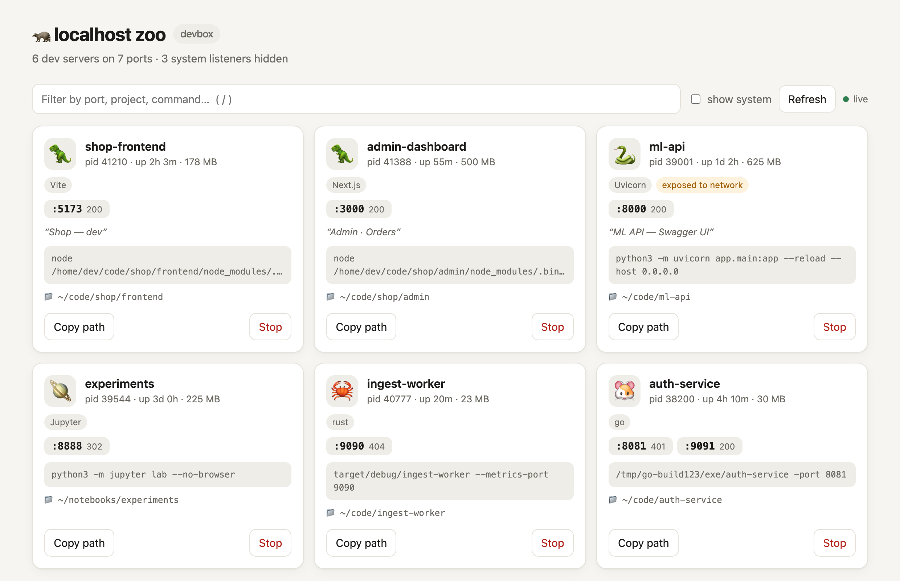

<div align="center">

# 🦝 localhost-zoo

**Все dev-серверы на машине в одной живой панели.**

Узнай, кто занял порт 3000, к какому проекту он относится и не открыт ли он на всю сеть. И останови его в один клик.


панель + CLI · без зависимостей · слушает только localhost · работает через SSH

[English](README.md)

<picture>
  <source media="(prefers-color-scheme: dark)" srcset="assets/dashboard-dark.png">
  
</picture>

</div>

---

## ✨ Возможности

- 🔎 **Находит всё, что слушает порты.** Vite, Next.js, Django, Rails, Uvicorn, Jupyter, Postgres, Redis, Docker, забытый `python -m http.server`…
- 📁 **Знает, откуда процесс.** Показывает рабочую папку, имя проекта из `package.json`, `pyproject.toml`, `go.mod` или `Cargo.toml` и фреймворк по командной строке.
- 🌐 **Заглядывает на страницу.** HTTP-статус и `<title>`: вместо «:5173» видно «Shop — dev».
- ⚠️ **Предупреждает об открытых портах.** Сервер на `0.0.0.0` доступен из Wi-Fi или из интернета, и панель это помечает.
- 🛑 **Останавливает процессы.** Два клика по Stop — SIGTERM. Shift+клик — принудительно, SIGKILL.
- 🦉 **Прячет лишнее.** Системные процессы (sshd, AirPlay, VPN) скрыты, пока не попросишь.
- 🖥 **Есть CLI.** `zoo list` и `zoo kill 3000` работают прямо в терминале.
- 🌗 **Светлая и тёмная тема**, автообновление, `/` для поиска.

## 🚀 Установка

```bash
npm install -g github:koigkio/localhost-zoo
```

Запуск:

```bash
zoo
```

Панель откроется на http://localhost:4321.

**Нужен** Node.js 18 или новее.

| Система | Что сделать |
|---|---|
| macOS | `brew install node` или скачать с [nodejs.org](https://nodejs.org) |
| Ubuntu / Debian | `curl -fsSL https://deb.nodesource.com/setup_22.x \| sudo -E bash - && sudo apt-get install -y nodejs` |
| Другой Linux | [nodejs.org/en/download](https://nodejs.org/en/download) |

Хочешь просто посмотреть? `zoo --demo` открывает панель с выдуманными серверами, и ничего по-настоящему не останавливается.

## 🎛 Команды

| Команда | Что делает |
|---|---|
| `zoo` | открыть панель |
| `zoo list` | dev-серверы таблицей в терминале |
| `zoo list --all` | то же, вместе с системными процессами |
| `zoo kill 3000` | остановить то, что слушает порт 3000 |
| `zoo kill 3000 -f` | то же, через SIGKILL |
| `zoo --json` | сырой результат в JSON, для скриптов |
| `zoo --demo` | панель с демо-данными |

| Опция | По умолчанию | Что значит |
|---|---|---|
| `-p`, `--port` | `4321` | порт панели |
| `-H`, `--host` | `127.0.0.1` | адрес; любой, кроме loopback, требует токен |
| `--no-open` | | не открывать браузер |

```
PORT  PID    WHAT           KIND     UP  WHERE
3000  41388  admin          Next.js  1h  ~/code/shop/admin
5173  41210  shop-frontend  Vite     2h  ~/code/shop/frontend
8000  39001  ml-api         Uvicorn  1d  ~/code/ml-api
```

## 🌍 На удалённом сервере

Панель слушает только `127.0.0.1` сервера, поэтому снаружи до неё не достучаться. Открывай её через SSH-туннель со своего ноутбука:

```bash
ssh -L 4321:localhost:4321 root@your-server 'zoo --no-open'
```

Потом открой http://localhost:4321 у себя. Панель работает, пока открыт SSH.

Чтобы видеть процессы других пользователей (системный nginx, Postgres, Docker), запускай `zoo` от root.

<details>
<summary><b>Открыть без туннеля</b></summary>

```bash
zoo --host 0.0.0.0
```

Программа напечатает ссылку вида `http://<ip-сервера>:4321/?t=<токен>`. Без токена панель не откроется.

Учти: трафик идёт по обычному HTTP, а панель может остановить любой процесс, доступный пользователю. Тот, кто увидит ссылку, сможет так же. Подходит для быстрого взгляда, не для постоянной работы.

</details>

## ⚙️ Как это работает

```
zoo
 │
 ├─ кто слушает порты?  macOS: lsof -iTCP -sTCP:LISTEN
 │                      Linux: ss -ltnp   (если нет — lsof)
 │
 ├─ для каждого процесса  ps        → команда, время работы, память
 │                        cwd       → /proc/<pid>/cwd или lsof -d cwd
 │                        проект    → ближайший package.json / pyproject.toml / go.mod …
 │                        фреймворк → по командной строке
 │
 ├─ HTTP-проверка        GET / с таймаутом 0.7 с → статус + <title>
 │
 └─ панель               http://127.0.0.1:4321, обновление каждые 3 с
```

**Кто есть кто:**

| | | | |
|---|---|---|---|
| 🦖 Node.js | 🐍 Python | 🦀 Rust | 🐹 Go |
| 🦕 Deno | 🐰 Bun | 🐞 Ruby | 🐘 PHP · PostgreSQL |
| 🐬 MySQL | 🦊 Redis | 🐳 Docker | 🪐 Jupyter |
| 🦜 Storybook | 🦉 системный | 🦝 неизвестный | |

## 🛡 Безопасность

Кнопка Stop действительно убивает процессы, поэтому панель осторожна:

- По умолчанию слушает только `127.0.0.1`.
- Проверяет заголовок `Host`, поэтому сайт, который ты открыл, не доберётся до неё через DNS rebinding.
- Для остановки нужен случайный токен, который создаётся при каждом запуске, и запрос со страницы самой панели.
- Останавливает только процессы из текущего скана: никаких произвольных PID и никогда саму себя.
- Если `--host` не loopback, токен нужен для любого запроса.

## 🗺 Планы

- [x] macOS и Linux
- [x] Определение проекта и фреймворка, HTTP-проверка
- [x] CLI: `list`, `kill`, `--json`
- [x] Демо-режим
- [ ] Windows (`netstat -ano` + `Get-Process`)
- [ ] Имена Docker-контейнеров вместо `docker-proxy`
- [ ] Кнопка «открыть в редакторе»
- [ ] Кнопка перезапуска (та же команда в той же папке)
- [ ] Приложение в строке меню / трее

Добавить фреймворк — одна строка в `src/scan.js`.

## 📄 Лицензия

[MIT](LICENSE) © koigkio
